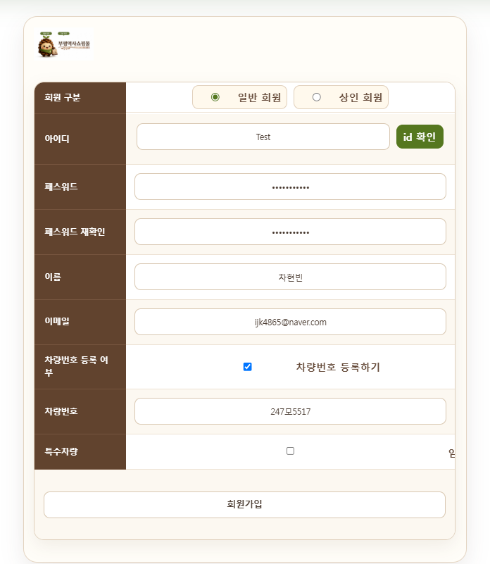
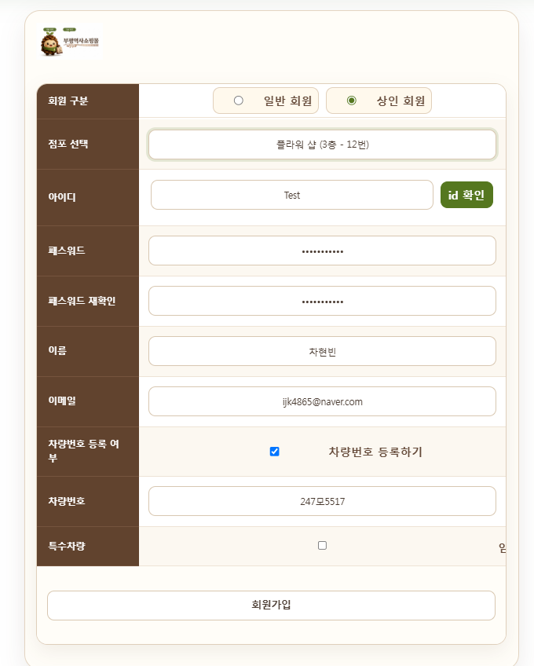
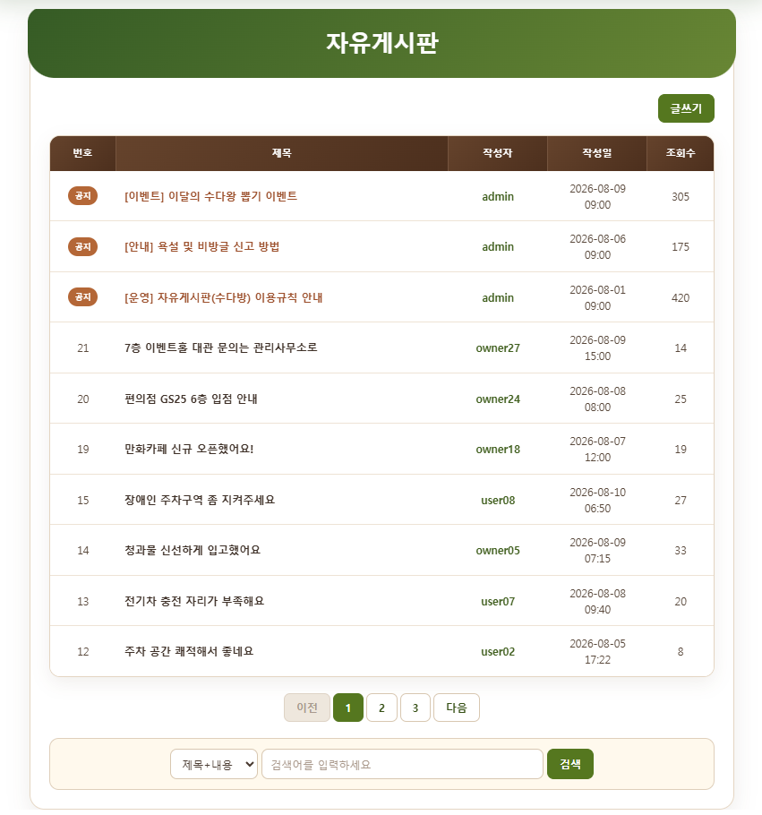
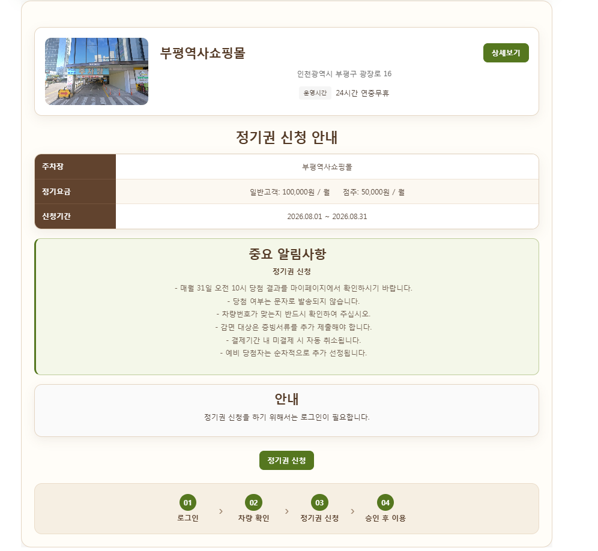
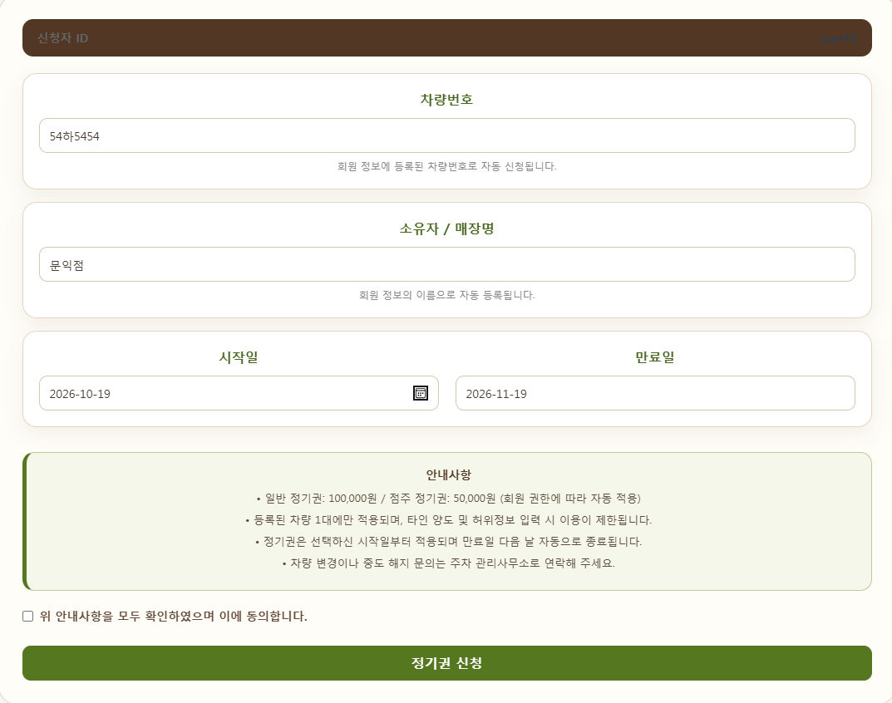
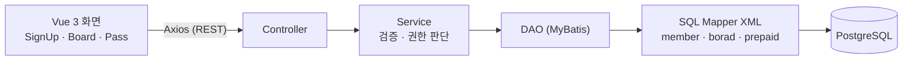

# 부평역사쇼핑몰 주차관리 시스템 — 회원가입 · 자유게시판 · 정기권

수기로 처리하던 주차장 정기권 신청과 요금 정산을 온라인으로 옮긴 웹 서비스입니다.
팀 프로젝트에서 제가 맡은 **회원가입, 자유게시판, 정기권(신청 · 안내 · 현황 화면)** 기능만 모은 저장소입니다.

## 프로젝트 정보

| 항목 | 내용 |
| --- | --- |
| 프로젝트 | 부평역사쇼핑몰 지능형 주차관리 시스템 (에스트래픽 풀스택 과정 3조 팀 프로젝트) |
| 기간 | 2026.07.23 ~ 2026.08.14 |
| 인원 | 6명 (최종 발표 담당) |
| 내 담당 | 회원가입, 자유게시판(글 · 댓글), 정기권 신청 · 안내 · 현황 — 화면(Vue)과 API(Spring Boot) |
| 기술 스택 | Vue 3, Axios, Java 17, Spring Boot, MyBatis, PostgreSQL |

## 화면

| 회원가입 (일반 회원) | 회원가입 (상인 회원) | 자유게시판 |
| --- | --- | --- |
|  |  |  |

| 정기권 신청 안내 | 정기권 신청 |
| --- | --- |
|  |  |

## 구조



Controller → Service → DAO → Mapper XML 구조로 나눠, 요청 처리 · 업무 규칙 · SQL을 각각 다른 계층에 두었습니다.

## API

| 기능 | Method | Endpoint | 설명 |
| --- | --- | --- | --- |
| 회원 | POST | `/addmember` | 회원가입 (일반 · 상인, 상인은 점포 연결) |
| 회원 | POST | `/idcheck` | 아이디 중복확인 |
| 자유게시판 | GET | `/boardlist` | 목록: 제목 · 내용 / 작성자 검색, 페이징, 상단 고정 우선 정렬 |
| 자유게시판 | POST | `/writeboard`, `/detailboard` | 글 작성, 상세 조회 (조회수 증가) |
| 자유게시판 | POST | `/updateboard`, `/deleteboard` | 수정 · 삭제 (작성자 본인 또는 관리자) |
| 자유게시판 | GET · POST | `/commentlist`, `/addcomment`, `/deletecomment` | 댓글 목록 · 작성 · 삭제 |
| 정기권 | GET | `/prepaid/status` | 발매 현황 (승인되고 유효 기간 안인 정기권만 집계) |
| 정기권 | GET | `/prepaid/my-status` | 내 정기권 신청 · 이용 현황 |
| 정기권 | POST | `/prepaid/apply` | 정기권 신청 |

## 구현 내용

### 회원가입
- 일반 회원과 상인 회원을 나눠 받고, 상인은 가입할 때 점포를 골라 소유주로 연결합니다. 이미 주인이 있는 점포는 바뀌지 않도록 SQL 조건으로 막았습니다.
- 차량번호 형식(`123가4567`)은 화면과 서버에서 **둘 다** 정규식으로 검사합니다.
- 아이디 중복확인 뒤 아이디를 고치면 확인 상태를 초기화해, 다시 확인해야 가입할 수 있습니다.

### 자유게시판
- MyBatis 동적 SQL로 "제목 + 내용" 또는 "작성자" 검색을 하나의 쿼리로 처리하고, `LIMIT / OFFSET`으로 페이징했습니다.
- 관리자 글은 상단에 고정되도록 정렬했습니다.
- 수정 · 삭제 권한은 화면에서 버튼을 숨기는 것과 별도로 **서버에서 다시 판단**합니다. DB에서 요청한 사람의 권한을 조회해 관리자면 허용하고, 아니면 작성자가 같을 때만 수정 · 삭제됩니다.

### 정기권 신청
- 시작일을 고르면 만료일(1개월 후)이 자동으로 계산되고, 안내사항에 동의해야 신청됩니다.
- 신청할 때 서버에서 세 가지를 확인합니다.
  1. 아직 승인되지 않은 신청이 있으면 중복 신청 차단
  2. 출차하지 않은 차량이면 신청 차단
  3. 회원 권한에 따라 요금 자동 결정 (일반 100,000원 / 상인 50,000원)
- 막힌 이유를 코드(`ALREADY_REQUESTED`, `CURRENTLY_PARKED` 등)로 돌려주고, 화면에는 이유에 맞는 안내 문구를 보여줍니다.

## 개선할 점

- **비밀번호 암호화**: 지금은 비밀번호를 그대로 저장합니다. BCrypt로 해시해 저장하도록 바꿔야 합니다.
- **사용자 확인**: 수정 · 삭제 요청의 작성자 ID를 화면이 보내는 값으로 받습니다. 서버 세션이나 토큰에서 로그인한 사용자를 꺼내 쓰도록 바꿔야 합니다.
- **중복 아이디**: 가입 시 아이디 중복은 DB 고유 제약에 의존합니다. 저장 전에 서버에서 한 번 더 확인하고 명확한 오류 메시지를 주는 것이 좋습니다.

## 파일 구성

```
bupyeong-parking/
├── frontend/src/
│   ├── components/Member/   # SignUp.vue
│   ├── components/Board/    # BoardList.vue, BoardDetail.vue, BoardWrite.vue
│   ├── components/Pass/     # Pass.vue, PassApply.vue, PassInfo.vue, PassNow.vue
│   └── router/              # Board, Pass 라우트
├── backend/
│   ├── src/main/java/com/mbc/project/
│   │   ├── controller/      # MemberController, BoardController, PrepaidController
│   │   ├── service/         # MemberService, BoardService, PrepaidService
│   │   ├── dao/  dto/
│   │   └── DataBaseConfig, WebConfigurer, ProjectApplication  # 팀 공통 설정
│   └── src/main/resources/sqls/   # member.xml, borad.xml, prepaid.xml
└── docs/                    # 화면 캡처
```

> 팀 프로젝트 전체가 아니라 제 담당 파일만 모았기 때문에, 이 저장소만으로는 전체 서비스가 실행되지 않습니다.
>
> **팀원 담당 부분**: 같은 파일 안에 있는 로그인 · 아이디 찾기(`MemberController`의 `/login`, `/findid`, `member.xml`의 해당 쿼리)와 관리자 정기권 승인(`PrepaidController`의 `/prepaid/pending`, `/prepaid/updateStatus`)은 팀원이 구현했습니다.
> `DataBaseConfig`, `WebConfigurer`, `ProjectApplication`, `pom.xml`, `application.properties`는 팀 공통 설정입니다.
> DB 비밀번호는 환경변수 `DB_PASSWORD`로 설정합니다.
